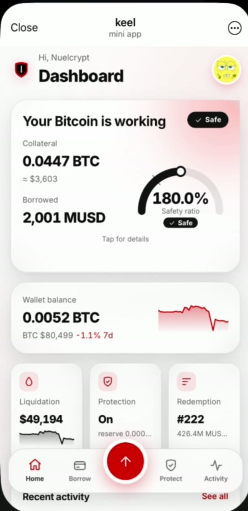
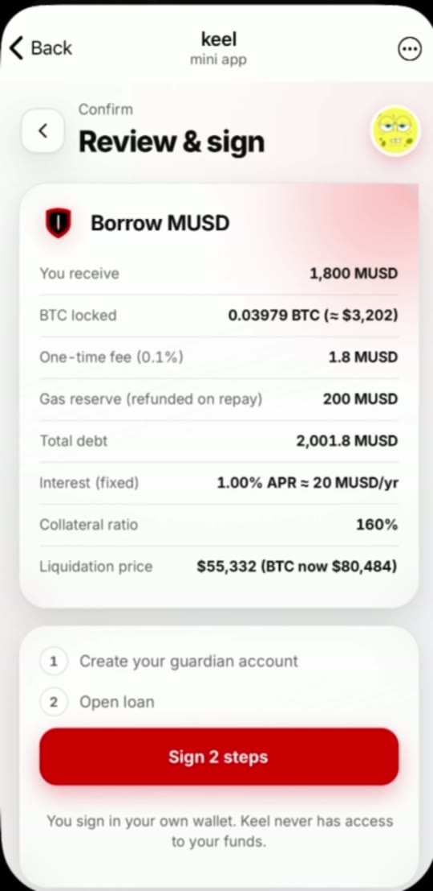
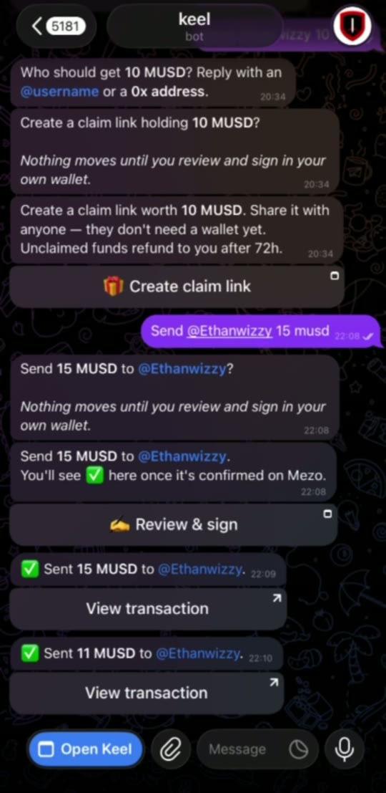
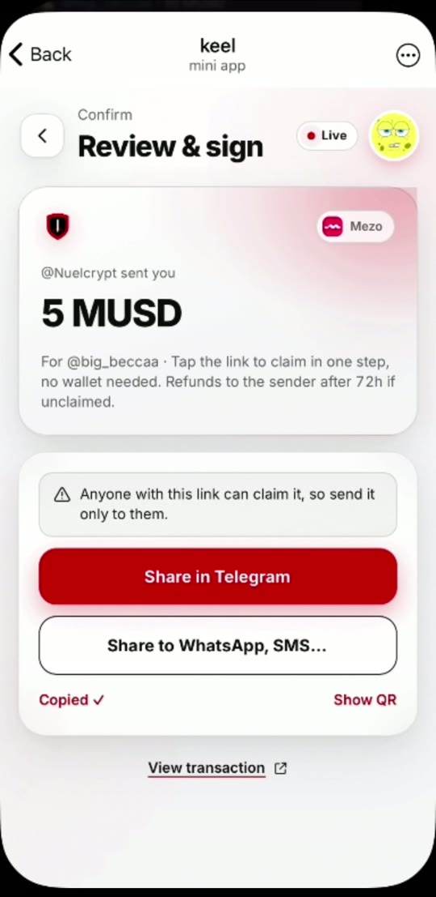
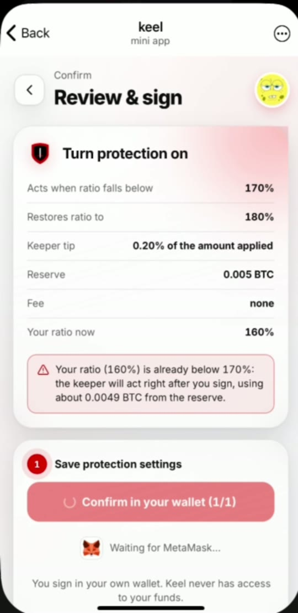
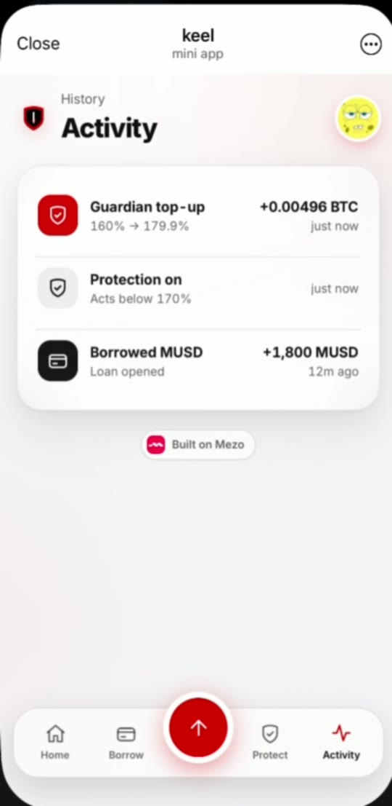
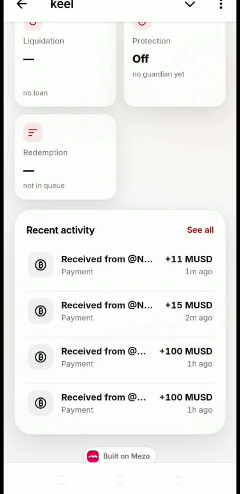
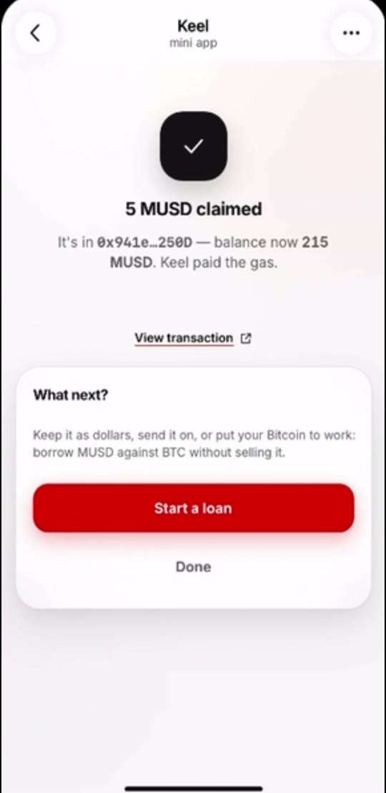
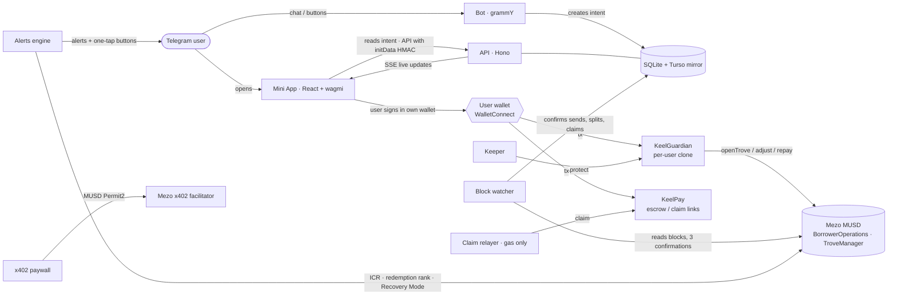

<p align="center">
  
</p>

<h1 align="center">Keel</h1>

<p align="center">
  <b>Your BTC-backed dollar account inside Telegram.</b><br/>
  Borrow MUSD against Bitcoin on Mezo, get protected from liquidation automatically, and send, split and claim payments with anyone.
</p>

<p align="center">
  <a href="https://mezo.org"></a>
  <a href="https://explorer.test.mezo.org"></a>
  
  <a href="LICENSE"></a>
</p>

<p align="center">
  <a href="https://t.me/KeelMezoBot"><b>Bot</b></a> ·
  <a href="https://t.me/KeelMezoBot/app"><b>Mini App</b></a> ·
  <b>Demo video</b> (link coming soon) ·
  <b>Deck</b> (link coming soon) ·
  <a href="docs/STATUS.md">Testnet evidence</a>
</p>

<p align="center">
  
  
  
  
</p>

---

## What Keel is

Bitcoin holders want dollars without selling their Bitcoin. Mezo's MUSD makes that possible: a fixed-rate loan against BTC. But using it today means a DeFi dashboard, a ratio to manage, and the risk of being liquidated or redeemed while you sleep.

Keel puts that whole account in the app people already use every day. You chat with a bot, review the details in a Mini App, and sign in **your own wallet**. Keel never holds your keys or your funds.

## The four pillars

### 1. Borrow, with guardrails

- Borrow MUSD against BTC from chat ("borrow 1800 at 160%") or from the Mini App.
- Before you sign you see the 0.1% fee, the fixed interest, your collateral ratio and your liquidation price.
- Unsafe loans are blocked before signing, not just flagged with a warning. This covers loans under the 1,800 MUSD minimum, under 110%, or under 150% while Mezo is in Recovery Mode.
- Repay, add collateral, or close the loan. Repayments follow Mezo's minimum-debt rule, so a transaction Mezo would reject can't be sent.

### 2. Guardian protection, with a permissionless keeper

- Each loan lives in its own **guardian** contract (an EIP-1167 clone).
- You fund a small BTC (or MUSD) reserve and pick a trigger, for example "below 170%, bring me back to 180%".
- When the ratio drops below the trigger, **anyone** can call `protect()`. Keel runs a keeper that does this.
- A keeper can only move your reserve into your own loan, with a cooldown and a tip capped at 1%. It can't withdraw, borrow or redirect anything.

### 3. Risk alerts

Keel watches three risks for you and sends early alerts:

- **Liquidation:** your ratio is near the 110% line.
- **Redemption queue:** Mezo redeems the lowest-ratio loans first, so Keel tells you your rank and how much MUSD is ahead of you.
- **Recovery Mode:** the system ratio has fallen below 150%.

Alerts use hysteresis, so you are not spammed. Every alert has one-tap buttons that open a ready-made review screen: add collateral, repay, fund the reserve, or turn on protection.

### 4. Payments

- **Send to @username:** works in chat or in the Mini App. Success is shown only after the transaction is confirmed on Mezo, and the recipient gets a Telegram notice.
- **Bill splits:** equal, custom or percentage shares, posted as a live card in a group or a DM, with Pay buttons and reminders. Each payment is matched on-chain, and the card updates as people pay.
- **Group requests:** "who owes what" in a group, with ✅/⏳ updating live.
- **Escrowed claim links:** pay someone who has no wallet yet. The MUSD is escrowed in `KeelPay` and the link opens straight in the Mini App. The recipient claims in one step and **Keel pays the gas**. Unclaimed links refund to the sender after 72 hours, and the sender can cancel at any time.
- **Live account:** balances and an activity feed that update in real time (server-sent events), plus one history across chat and the Mini App.

**Also included, and working:**

- **Natural-language chat**, for example "how safe is my loan?", "what if BTC drops 20%?" or "send 20 to @ada for lunch". It uses a deterministic parser with no LLM and no external calls, repeats the amount and recipient back before acting, and asks when something is missing.
- **x402 premium alerts:** pay-per-use near-real-time monitoring, paid in MUSD with a Permit2 signature through the Mezo x402 facilitator. Settlement was proven on testnet.

| Protection review | Guardian top-up | Payment received | Claim link, claimed |
|:-:|:-:|:-:|:-:|
|  |  |  |  |

## Why it's different

- **Built for Telegram.** You chat, review and sign without leaving Telegram, and you can pay anyone who has a Telegram account, even without a wallet.
- **Protection that acts, not just alerts.** Most tools tell you that you're about to be liquidated. Keel's guardian fixes the ratio on-chain, using only funds you set aside for that purpose.
- **Honest about Mezo's rules.** MUSD has a **1,800 MUSD minimum net debt** and a 200 MUSD gas reserve, and repayments can't go below them. Keel builds those rules into every quote, repay screen and alert button, so you're never offered a transaction Mezo would reject. It also explains why: "this loan can't be partly repaid, close it instead".
- **Payments make new users.** Every claim link and split helps someone new start using MUSD, because they can claim without gas and without a wallet.
- **Non-custodial by design.** The server only ever creates *intents*. Every fund-moving action is signed by the user in their own wallet.

## Architecture



| Path | What lives there |
|---|---|
| [`contracts/contracts/keel/`](contracts/contracts/keel) | `KeelGuardian`, `KeelGuardianFactory`, `KeelPay` |
| [`contracts/`](contracts) | Fork of mezo-org/musd: Keel's contracts are tested against the real protocol |
| [`shared/`](shared) | ABIs, chain config, deployments, risk maths (ICR, liquidation price, quotes, redemption rank), batched readers |
| [`bot/`](bot) | Telegram bot, HTTP API, alerts, keeper, claim relayer, block watcher, live updates, x402 premium, testnet scripts |
| [`miniapp/`](miniapp) | The Mini App: dashboard, borrow, protect, pay, splits, claim, activity, wallet linking, review-and-sign |
| [`docs/`](docs) | [Deployment](docs/DEPLOY.md), [status and testnet evidence](docs/STATUS.md), [submission text](docs/SUBMISSION.md) |

## How Keel integrates Mezo and MUSD

- **BTC collateral and MUSD loans.** Loans are opened through Mezo's `BorrowerOperations`, called from the user's guardian. Native BTC is sent as `msg.value`, and the insert hints come from `HintHelpers.getApproxHint` and `SortedTroves.findInsertPosition`.
- **Risk reads.** Keel reads straight from `TroveManager`, `PriceFeed`, `InterestRateManager` and `SortedTroves` using batched JSON-RPC. That gives each loan's ratio, liquidation price, redemption-queue rank and the Recovery Mode check (TCR < 150%).
- **Protocol constants are respected:**
  - minimum collateral ratio 110%;
  - critical (Recovery Mode) ratio 150%;
  - 0.1% borrow fee;
  - 1,800 MUSD minimum net debt;
  - 200 MUSD gas compensation;
  - fixed interest.
- **MUSD as money.** MUSD is the unit for loans, payments, splits, claim-link escrow and x402. x402 uses the token's ERC20Permit (EIP-2612) and Permit2.

**Deployed contracts on Mezo testnet (chain 31611):**

| Contract | Address |
|---|---|
| KeelGuardianFactory | [`0x44AA5CBb78eA506Fd91FA7942d9326De29bF2E49`](https://explorer.test.mezo.org/address/0x44AA5CBb78eA506Fd91FA7942d9326De29bF2E49) |
| KeelPay | [`0xa0C53049202A655f5Ca5fE3131971C1B79cBEe29`](https://explorer.test.mezo.org/address/0xa0C53049202A655f5Ca5fE3131971C1B79cBEe29) |
| MUSD (Mezo) | [`0x118917a40FAF1CD7a13dB0Ef56C86De7973Ac503`](https://explorer.test.mezo.org/address/0x118917a40FAF1CD7a13dB0Ef56C86De7973Ac503) |
| BorrowerOperations (Mezo) | [`0xCdF7028ceAB81fA0C6971208e83fa7872994beE5`](https://explorer.test.mezo.org/address/0xCdF7028ceAB81fA0C6971208e83fa7872994beE5) |
| TroveManager (Mezo) | [`0xE47c80e8c23f6B4A1aE41c34837a0599D5D16bb0`](https://explorer.test.mezo.org/address/0xE47c80e8c23f6B4A1aE41c34837a0599D5D16bb0) |
| PriceFeed (Mezo) | [`0x86bCF0841622a5dAC14A313a15f96A95421b9366`](https://explorer.test.mezo.org/address/0x86bCF0841622a5dAC14A313a15f96A95421b9366) |

The source of truth is [`shared/deployments/testnet.json`](shared/deployments/testnet.json) (Keel) and [`shared/deployments/musd.json`](shared/deployments/musd.json) (Mezo).

## Security model

- **Keel never holds keys or funds.** The bot creates intents, and the user signs every fund-moving transaction in their own wallet. The server marks an intent done only after it has checked the confirmed receipt against the user's linked wallet.
- **Identity.**
  - Every API call is checked with Telegram `initData` HMAC.
  - A wallet is linked to a Telegram account by signing a single-use nonce, which expires after 10 minutes.
  - Each user's data is isolated to their own account (audited).
- **Guardian.**
  - Only the owner can take funds out.
  - `protect()` can only move reserve funds into the owner's own loan, subject to a cooldown, a tip of at most 1% and a target ratio of at most 500%.
  - Fund-moving functions are `nonReentrant`.
  - Ownership transfer takes two steps.
- **Claim links.**
  - The claim key exists only in the link. It is 43 characters of base64url so it fits Telegram's `startapp` limit, and it goes straight to the Mini App without reaching the bot.
  - The claim signature binds the destination address, so neither the relayer nor a mempool observer can redirect the funds.
  - The sender can cancel at any time, and expired links refund to the sender.
- **Payments are only reported once they are final.** The block watcher waits 3 confirmations, uses a persisted cursor and a 30-block overlap, and deduplicates by event. Sends and splits are settled only once they are confirmed.
- **Secrets** (bot token, keeper, relayer and deployer keys, database tokens) exist only as host environment variables. They have never been in git, and the full history was scanned with gitleaks plus an exact-value search.
- **Not audited.** This is testnet software. Don't put funds you can't afford to lose into a mainnet deployment.

## Feature status

An honest view of what is done. Each testnet row has transaction hashes in [docs/STATUS.md](docs/STATUS.md).

| Feature | Status |
|---|---|
| Borrow with confirmation card, fee, interest, ratio and liquidation price | ✅ Done, proven on testnet |
| Add collateral, partial repay that respects the Mezo minimum | ✅ Done, proven on testnet |
| Guardian reserve and keeper `protect()` (159.9% → 179.9%) | ✅ Done, proven on testnet |
| Liquidation-risk and redemption-queue alerts with one-tap actions | ✅ Done, delivered live from real testnet data |
| Send MUSD to @username, recipient notice, confirmed-only success | ✅ Done, proven on testnet (17/17 checks) and between two phones |
| Escrowed claim links with gasless claim, cancel and refund | ✅ Done, proven on testnet and claimed on a phone |
| Bill splits and group requests with on-chain payment matching | ✅ Done, proven on testnet (29/29 checks, together with claim links) |
| Live balances, activity and history (SSE) | ✅ Done, running in production |
| x402 premium alerts paid in MUSD | ✅ Done, settlement proven on testnet |
| Natural-language chat (rule-based) | ✅ Done, running in the live bot |
| Recovery Mode alert | 🧪 Built and tested locally (can't be forced on a shared testnet) |
| Close loan (repay everything) | 🧪 Built; covered by contract tests, not yet run on testnet |
| Withdraw-collateral screen, savings in the Stability Pool | 🗓 Planned |
| Multi-keeper network, fiat off-ramp partners, mainnet after an audit | 🗓 Planned |

## Run locally

Requirements: Node 22+ and pnpm 10.

```bash
pnpm install
cp .env.example .env                    # names only; fill in your own values
cp miniapp/.env.example miniapp/.env.local
```

**Option A: everything on a local chain, using the real MUSD contracts.**

```bash
cd contracts && KEEL_SOLCJS=1 pnpm dev:chain     # terminal 1: local chain with seeded troves
cd bot && pnpm tsx scripts/e2e-local.ts           # terminal 2: borrow → protect → send → claim, end to end
```

**Option B: the bot and the Mini App against Mezo testnet.**

```bash
pnpm --filter @keel/miniapp dev                   # Mini App on :5173
pnpm --filter @keel/bot dev                       # bot + API + alerts + keeper + watcher on :8787 (long polling)
```

Then, in BotFather:

1. Run `/newbot`.
2. Run `/newapp` and point it at your `MINIAPP_URL`. It must be an HTTPS tunnel or host.
3. Optionally set a Direct Link short name and use it as `MINIAPP_SHORTNAME`.

Every environment variable is listed, without values, in [`.env.example`](.env.example), [`bot/.env.example`](bot/.env.example), [`miniapp/.env.example`](miniapp/.env.example) and [`contracts/.env.example`](contracts/.env.example).

## Deploy

- **Contracts:** run `cd contracts && pnpm deploy:keel:testnet`. It writes `shared/deployments/testnet.json`.
- **Bot and API:** Render web service (`render.yaml`), using the SQLite store mirrored to Turso, with cron-job.org calling the `/ops` tick endpoints.
- **Mini App:** Vercel, using the root `vercel.json`, with `VITE_API_BASE` and `VITE_WC_PROJECT_ID` set in the project.

The full step-by-step guide is in [docs/DEPLOY.md](docs/DEPLOY.md).

## Tests

```bash
pnpm --filter @keel/bot test        # 224 tests: handlers, API, alerts, keeper, payments, splits, claims, watcher, NLU
pnpm --filter @keel/shared test     # 25 tests: risk maths and readers
pnpm --filter @keel/miniapp test    # 12 tests
cd contracts && pnpm test:keel      # 24 tests: Keel contracts against the real MUSD stack
```

Testnet end-to-end scripts are in `bot/scripts/`. They need funded testnet keys in `.env`.

| Script | What it covers |
|---|---|
| `payments-testnet.ts` | Sends, receives, history and notifications (17/17 checks) |
| `claims-splits-testnet.ts` | Claim links and bill splits (29/29 checks) |
| `claimlink-testnet.ts` | Claim-link escrow, claim, cancel and refund |
| `x402-testnet.ts` | Premium alerts paid over x402 |
| `plan-testnet.ts` | Mini App transaction plans |

## Roadmap

- A withdraw-collateral screen in the Mini App, and Stability Pool savings.
- An open keeper registry, so any operator can run protection.
- Fiat on- and off-ramp partners for MUSD.
- A third-party audit, then mainnet.

## License and credits

Keel is released under the [GPL-3.0](LICENSE) license.

[`contracts/`](contracts) builds on the **MUSD protocol by Mezo / Thesis** ([mezo-org/musd](https://github.com/mezo-org/musd), GPL-3.0). Everything under `contracts/contracts/` except `keel/` is vendored unmodified, so that Keel's tests run against the real protocol.

Wallet logos in the Mini App come from the WalletConnect registry and belong to their owners.

See [NOTICE.md](NOTICE.md) for details. Built for the **Mezo Buildathon**.
