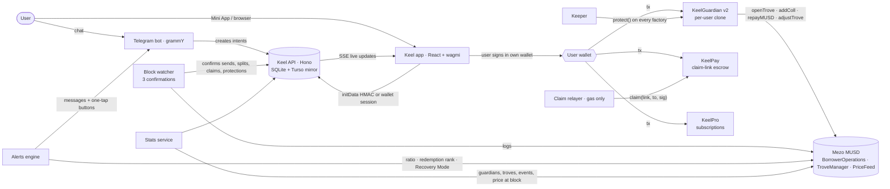

# Architecture

Keel has three parts:
- **contracts** on Mezo;
- an **API and bot server** (Node, Hono, grammY);
- a **React app** that runs as a Telegram Mini App and as a web app.

The server prepares intents and watches the chain. Every fund-moving transaction is signed by the user in their own wallet.

## Components

| Component | Where | What it does |
|---|---|---|
| **KeelGuardianFactoryV2 + KeelGuardianV2** | `contracts/contracts/keel/` | One clone per user that owns the MUSD trove; permissionless `protect()` with full, partial or insufficient results; the protocol share of the tip |
| **KeelPay** | `contracts/contracts/keel/KeelPay.sol` | Claim-link escrow with an EIP-712 `Claim(link, to)` signature, expiry and refund |
| **KeelPro** | `contracts/contracts/keel/KeelPro.sol` | MUSD subscriptions paid straight to the treasury |
| **API** | `bot/src/api.ts`, `app-api.ts`, `web-auth.ts` | Auth (Telegram initData or wallet session), intents, splits, claim relay, live updates (SSE), public stats |
| **Bot** | `bot/src/bot.ts`, `chat.ts`, `nlu.ts` | Commands and rule-based natural language (no LLM); posts split and request cards |
| **Keeper** | `bot/src/keeper.ts` | Scans every guardian on every factory; calls `protect()` when `protectionStatus()` says it would move funds |
| **Block watcher** | `bot/src/watcher.ts` | Confirms payments, splits, claim links and protections from on-chain logs; sends notices; keeps a persisted cursor |
| **Alerts** | `bot/src/alerts.ts` | Ratio, redemption queue, Recovery Mode and reserve coverage, with hysteresis |
| **Stats** | `bot/src/stats.ts` | Public on-chain stats: guardians, loans, protections with the price at the block, trigger classification, revenue |
| **App** | `miniapp/src/` | Review-and-sign screens, dashboard, payments, splits, web sign-in, demo mode, landing page, these docs |
| **Shared** | `shared/src/` | ABIs, deployments, risk maths (ratio, liquidation price, quotes, redemption rank), chain readers |

## Data flow: a borrow

1. **Request.** You ask to borrow, in chat or in the app.
2. **Intent.** The API stores an intent: type, amount and target ratio, owned by your account.
3. **Plan.** The app reads Mezo directly (price, fee, minimum) and builds the plan:
   - create your guardian if needed;
   - `openTrove` through the guardian, with on-chain hints.
4. **Sign.** You review the plan and sign. The app reports the transaction hash.
5. **Confirm.** The server checks the receipt was sent by your linked wallet, marks the intent done and pushes a live update.

## Hosting

| Part | Host |
|---|---|
| API and bot | Render (always-on via a scheduler); SQLite mirrored to Turso |
| App, landing and docs | Vercel |
| Contracts | Mezo testnet |
