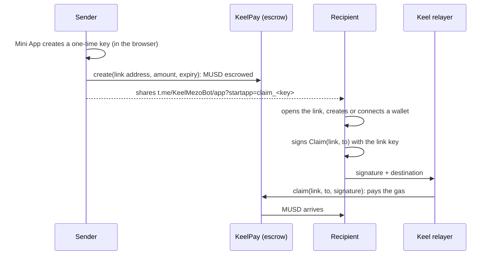

# Payments

All payments are **MUSD on Mezo**. Each one is a transaction you sign in your own wallet, and Keel shows it as sent **only after it is confirmed on-chain**, three blocks deep.

## Send to @username

`send 20 to @ada for lunch` in chat, or **Pay → Send** in the app. The recipient can be:
- a Keel user's @username, which Keel resolves to the wallet linked to that account;
- any 0x address.

If the @username has no wallet on Keel yet, Keel offers a **claim link** instead. Once the transfer confirms, the recipient gets a Telegram notice. If they've never started the bot, the notice waits for them.

## Split bills

**Pay → Split** or `/split 90 @ada @bob dinner`.

- Shares can be **equal**, **custom** amounts, or **percentages**, computed in whole cents.
- In a group, Keel posts a **live card**: each person taps **Pay**, signs, and the card ticks them off once the payment is matched **on-chain** (sender, recipient and amount).
- The creator can send **reminders**, and Keel can remind people automatically before a due date.
- If someone can't be reached on Telegram, Keel gives the creator a link to forward.

## Requests

`/request 25 for tickets` in a group posts a request anyone can pay. The message updates as payments confirm.

## Claim links

A claim link sends MUSD to **someone who has no wallet yet**.

**Security of the link key:**
- The key is created in the sender's browser and exists only inside the link. It is 43 characters of base64url, which fits Telegram's `startapp` limit. It goes straight to the Mini App and never reaches Keel's bot.
- Claiming needs a signature over `Claim(link, to)`, which binds the destination address. The relayer, or anyone watching the mempool, can't redirect the funds.
- **Anyone who has the link can claim it.** Send it only to the person it's for.

**Expiry and refund:**
- Links expire after 72 hours by default.
- An expired or cancelled link refunds the full amount to the sender. The sender can cancel at any time from **Activity**.

**Gas:** Keel's relayer pays the claim transaction's gas, so the recipient needs no BTC. If the relayer is low on gas, claims pause and Keel's admins are alerted; the link keeps working.

**Upgrades:** links made on the first KeelPay contract stay claimable and cancellable. Keel looks up which KeelPay holds each link.
