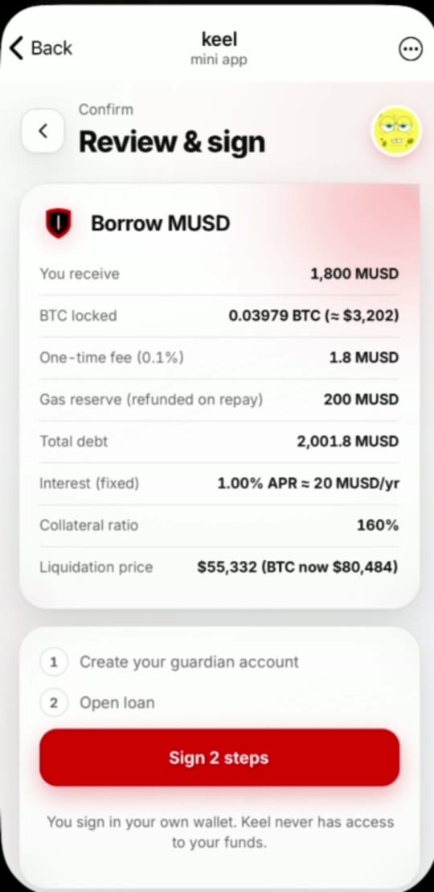
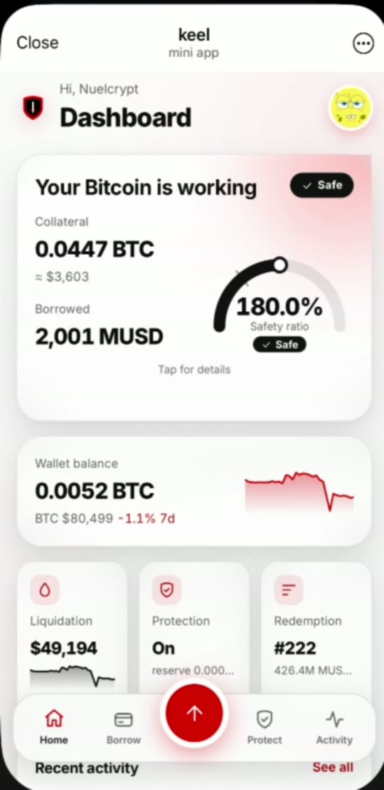
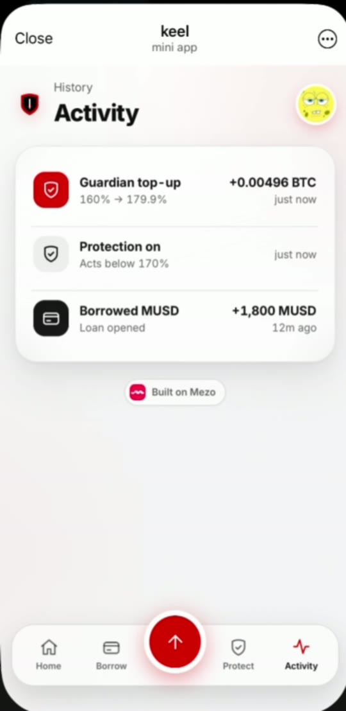
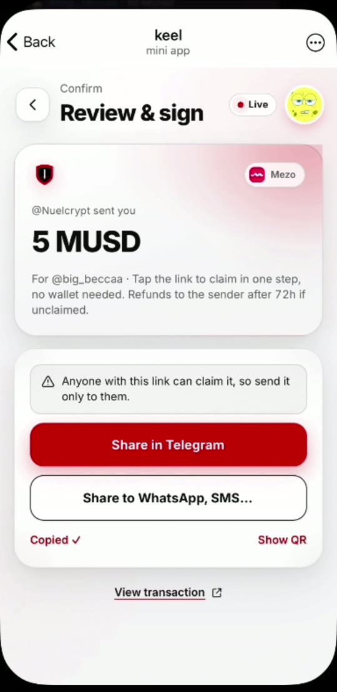

# Quick start

Try Keel on Mezo testnet in about two minutes. Everything here uses **testnet BTC**, which is free and worth nothing.

## 1. Pick how you want to open Keel

- **In Telegram:** open [t.me/KeelMezoBot/app](https://t.me/KeelMezoBot/app), or start a chat with [@KeelMezoBot](https://t.me/KeelMezoBot).
- **In a browser:** open [keel-miniapp.vercel.app](https://keel-miniapp.vercel.app/#/app) and tap **Open web app**. No Telegram is needed.
- **Just looking:** open the [demo](https://keel-miniapp.vercel.app/?demo=1#/). It shows every screen with sample data and signs nothing.

## 2. Connect a wallet

Use MetaMask, any browser wallet, or a mobile wallet through WalletConnect.
- **In the browser,** you sign one message that proves the wallet is yours. It costs nothing and moves no funds, and it starts a 12-hour session.
- **In Telegram,** you sign one message that links the wallet to your Telegram account.

Keel adds the Mezo network to your wallet if it's missing (Mezo testnet, chain id 31611).

## 3. Get testnet BTC

Get free testnet BTC from the Mezo faucet. Keep a little BTC for gas: Keel holds back about 0.002 BTC for fees.

## 4. Open your first loan

The smallest loan Mezo allows is **1,800 MUSD**. At a 160% ratio that needs about 0.05 BTC in your wallet, including fees.

In chat, send `borrow 1800 at 160%`, or open **Borrow** in the app.

Check the numbers and tap **Sign 2 steps**:
1. The first signature creates your guardian account.
2. The second opens the loan on Mezo.

The MUSD arrives in your wallet.

## 5. Turn on protection

1. Open **Protect**.
2. Fund the reserve with a small amount, for example 0.005 BTC. The reserve is only ever spent on protecting this loan, and you can withdraw it at any time.
3. Choose a trigger and a target, for example 170% and 180%, and sign.

Want to see it react to the market? Tap **Set to test**. It puts the trigger one point under your current ratio, so the next small dip in Mezo's BTC price makes the keeper act.

## 6. Pay someone

1. Open **Pay**.
2. Choose how to pay:
   - **Send** to any @username or 0x address;
   - **Split** a bill;
   - **Claim link** for someone with no wallet: they open the link, claim in one step, and Keel pays their gas.

## 7. Get alerts

- **In Telegram,** alerts arrive in your chat with the bot.
- **On the web,** use **Connect Telegram** in your profile to attach a Telegram account to the same wallet. Your history comes with it.
